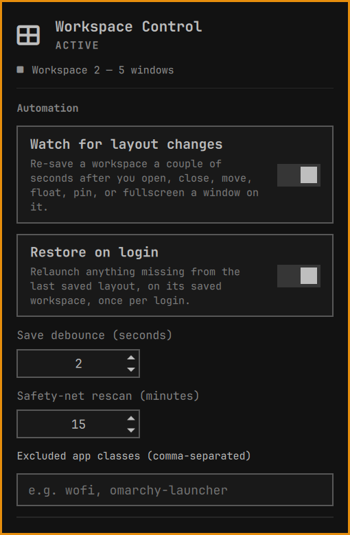
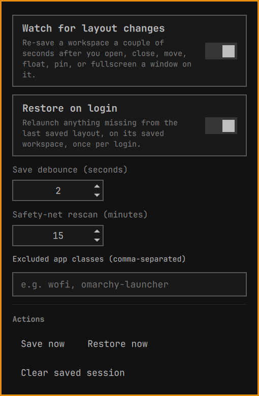

# Workspace Control

An Omarchy bar plugin for workspace-related features, growing over time.
The first feature: it remembers every window on every Hyprland workspace
and, after a reboot, logout, or crash, puts each one back on its workspace
at its exact position and size, tiled or floating.

Bar icon: a 2×2 grid glyph, left side of the bar by default. Left-click
opens the config screen; right-click triggers an immediate full save.

## How it works

- **Watching.** A background process listens to Hyprland's event socket
  and re-saves a workspace a couple of seconds after you open, close,
  move, float, pin, or fullscreen a window on it. Resizing a tiled split
  or dragging a window emits no Hyprland event, so the watcher also
  compares window rectangles every 5 seconds and re-saves any workspace
  whose geometry changed. Only changed workspaces are written.
- **Restoring exactly.** A dwindle workspace is a binary split tree, and
  the saved window rectangles are its leaves, so restore recovers the tree
  from the rectangles and rebuilds it one window at a time: open the first
  window, then for each split focus the window occupying it, `preselect`
  the direction and open the next one. Exact sizes are applied afterwards,
  which recreates the saved split ratios. Floating windows get their exact
  position and size; pinned and fullscreen state are reapplied, and focus
  returns to the workspace you were on.
- **Already-open windows are reused.** Anything open when restore runs
  (autostarted apps, or everything when you press "Restore now"
  mid-session) is moved into its saved slot instead of being launched a
  second time.
- **Launching.** Apps are relaunched with the arguments they were started
  with, through `uwsm-app` like Omarchy's own launchers, so each gets its
  own systemd scope and its output lands in `journalctl --user`.
  Terminals reopen in the directory their shell was last in.
- **Login ordering.** At login the watcher waits for that login's restore
  to finish before saving anything, so a half-restored desktop can never
  overwrite the saved layout. Each restore also keeps the layout it
  restored from in `session.pre-restore.json`.
- **Recovery protection.** If restoration fails, is interrupted, or cannot
  reopen every window, automatic saves pause so the original layout and
  backup survive retries and shell restarts. Click **Restore now** to retry,
  or **Save now** to explicitly replace the saved layout with the current
  desktop and resume automatic saves. **Clear saved session** removes both
  the saved layout and its recovery backup.
- **Concurrency.** Saves serialize their complete read/update/write cycle.
  Restoration excludes saves and rejects simultaneous restore attempts.
  Kernel locks release automatically if a process exits or crashes; they
  have no fixed expiry. Windows left in staging after an exception are
  returned to their original workspace on a best-effort basis.
- **Logging.** Everything the backend does, including any window that
  failed to come back and why, is logged to
  `~/.local/state/omarchy-workspace-control/workspace-control.log`.

## Requirements

- Omarchy's Hyprland fork with the `hl`/`hl.dsp.*` Lua dispatcher API
  (this plugin does **not** use upstream Hyprland's plain-text
  `hyprctl dispatch <disp> <args>` syntax — verified against Omarchy's
  Hyprland 0.56.2 build; if a future Omarchy/Hyprland release changes
  this API again, `scripts/restore.py` and `scripts/watch.py` are the
  only two files that call it).
- `python3` (stdlib only — no pip dependencies) and `jq`-free `hyprctl -j`
  JSON output, both standard on Omarchy.

## Install

```
git clone <this-repo> ~/.config/omarchy/plugins/jcallico.workspace-control
omarchy plugin enable jcallico.workspace-control left
```

(Or use `omarchy plugin add <git-url>` once published.) The plugin
hot-reloads automatically; no shell restart is required after install.

## Remove

```
omarchy plugin disable jcallico.workspace-control
rm -rf ~/.config/omarchy/plugins/jcallico.workspace-control
rm -rf ~/.local/state/omarchy-workspace-control
```

## Configuration

Click the plugin's bar icon to open its panel. It shows saved window counts
per workspace and controls automatic saving and login restoration.



| Setting | Default | Notes |
|---|---|---|
| Watch for layout changes | on | Turns the background watcher on/off |
| Restore on login | on | Rebuild the saved layout once per login |
| Save debounce (seconds) | 2 | Quiet period after the last change before saving |
| Safety-net rescan (minutes) | 15 | Periodic full resync with the live session |
| Excluded app classes | (none) | Comma-separated window classes to never save/restore |

State lives outside the plugin folder, under
`~/.local/state/omarchy-workspace-control/` (`session.json` for the saved
layout, `config.json` mirroring the settings above for the Python backend
to read) — deliberately outside `~/.config/omarchy/plugins/`, since
Omarchy hot-reloads plugin code on any write under that directory and
frequent state writes there would cause spurious reloads.

### Save, restore, and recovery

Scroll down in the panel to reach the manual actions:

- **Save now** replaces the saved layout with the current desktop.
- **Restore now** restores the saved layout, reusing already-open windows
  and launching any that are missing.
- **Clear saved session** deletes the saved layout and its recovery backup.



If a restore fails or is interrupted, automatic saves pause to protect the
saved layout. Use **Restore now** to retry, or **Save now** to accept the
current desktop and resume automatic saving.

## Known limitations

- Exact tiled placement assumes the dwindle layout (Omarchy's default).
- In-app state (browser tabs, open files, a terminal's running program's
  history) is up to each app; what's restored is the app, its launch
  arguments, its working directory and its window geometry.
- An app that opens extra windows on its own when launched (e.g. an editor
  restoring its previous windows) adds windows the saved layout doesn't
  know about.
- Windows on special (scratchpad) workspaces are reopened there but not
  repositioned.
- Depends on Omarchy's non-upstream Hyprland dispatcher API; a fork or
  major Hyprland version bump could change it again.

## Roadmap

This plugin is meant to grow into a general workspace toolkit, not stay
scoped to save/restore. Layout persistence is just the first feature.

## Tests

Run the isolated backend regression suite (Python standard library only):

```sh
python3 -B -m unittest discover -s tests -v
```

Tests use temporary state and mocked Hyprland commands; they do not move
real windows. Process-level cases cover concurrent saves, exclusive
restoration, and lock release after a killed process.
